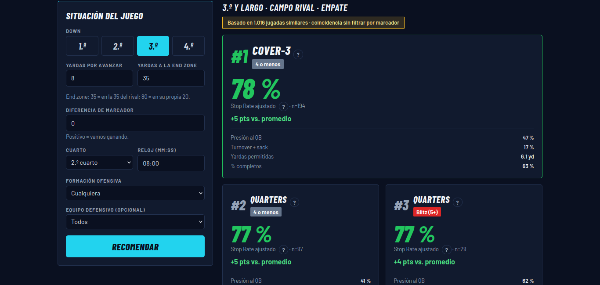

# DC Copilot

**Asistente de decisiones para el coordinador defensivo.** Dada la situación que el coach ve antes del snap (down, yardas por avanzar, zona del campo, marcador, reloj y formación ofensiva), DC Copilot recomienda la combinación **cobertura + presión** que históricamente más detuvo esa jugada. Muestra su tasa de éxito, el tamaño de muestra y una explicación en español generada con IA.

Proyecto del **NFL Big Data Bowl Hackathon UNAM 2026**. Punto de vista elegido: **Coach**.

## Hallazgo principal

**En 3.º y largo, mandar blitz detuvo menos que presionar con 4 o menos: 66.1 % contra 75.3 % de Stop Rate (−9.2 puntos; n=292 contra n=705).** El blitz sí incomoda más al mariscal (62 % de presión contra 46 %), pero no se traduce en más stops. Además, la presión simulada (mandar 4 pero mostrar más) detuvo al 57.5 % contra 51.8 % (n=221), con la mitad de jugadas grandes.

Fuente: 8,521 jugadas de pase de las semanas 1 a 8 de la temporada 2021 (Big Data Bowl, con datos de scouting de PFF). Los demás hallazgos están en la pestaña **Hallazgos** de la app.

## Cómo se evalúa

Cada criterio se califica de 1 a 5.

| Criterio | Qué busca el jurado | Puntaje | Cómo lo cubrimos |
|---|---|---|---|
| **Football Insight** | Un hallazgo que alguien de la liga pueda usar | de 1 a 5 | Separamos cobertura de presión, medimos el Stop Rate por situación y presentamos hallazgos concretos con su número y su n. |
| **Technical Execution** | Una app funcional con el stack fijo | de 1 a 5 | Pipeline pandas, FastAPI y React con Recharts. El recomendador es determinista y la IA es opcional con respaldo. Hay pruebas con pytest. |
| **Communication** | Explicar con claridad qué hicimos | de 1 a 5 | Este README con el hallazgo arriba, un Modo Coach de una sola pantalla, un glosario dentro de la app y un pitch de 2 minutos. |
| **Originality** | Diferenciarse de los demás | de 1 a 5 | Recomendación según la formación ofensiva, detección de presión simulada, ajuste por muestra pequeña, perfil de cada jugada y gráficas dibujadas sobre la cancha. |

## Qué hace

La app responde una pregunta de banda: *con este down, distancia, zona, marcador, reloj y esta formación ofensiva, ¿qué cobertura y cuánta presión llamo?*

- **Modo Coach:** formulario de situación y 4 escenarios rápidos. Devuelve el **top 3** de combinaciones cobertura + presión, una combinación **a evitar**, una insignia que indica en cuántas jugadas similares se basa y una caja para preguntarle a la IA en lenguaje natural.
- **Explorador:** filtros por down, distancia, zona, marcador, defensa y formación ofensiva. Incluye:
  - la **formación defensiva dibujada en la cancha**, con el perfil de dónde funcionó mejor (zona, down, rival, formación ofensiva y cuarto)
  - un **mapa de calor sobre la cancha** (down por zona)
  - gráficas de Stop Rate por cobertura y por formación defensiva
  - blitz vs. 4 o menos vs. presión simulada
  - presión contra yardas permitidas
- **Hallazgos:** los descubrimientos principales con su número y su n.

## Cómo impacta

- **Decisiones con evidencia:** el coordinador deja de decidir solo por instinto y por video. Ve qué funcionó en situaciones parecidas y con cuánta evidencia.
- **Honestidad estadística:** cada porcentaje lleva su n. Los grupos con menos de 15 jugadas se atenúan o se ocultan, y la insignia de confiabilidad avisa cuando se relajaron filtros para encontrar jugadas similares.
- **La IA no inventa números:** el ranking lo calcula pandas. La IA solo explica los resultados, y si falla el formulario sigue funcionando.
- **Útil para el rival también:** el coordinador ofensivo puede ver qué suele llamar una defensa en cada situación.

## Cómo se usa

1. Abre **Modo Coach** y elige un **escenario rápido** (por ejemplo "3.º y largo"), o captura la situación: down, yardas por avanzar, yardas a la end zone, marcador, cuarto, reloj y formación ofensiva.
2. Presiona **Recomendar**. Lee la insignia (verde: coincidencia casi exacta; ámbar: se quitó algún filtro; roja: muy general) y las tarjetas **#1, #2 y #3**.
3. Revisa la tarjeta **Evitar** y la gráfica comparativa con el promedio.
4. Si prefieres escribir, usa **Pregúntale al asistente**. Por ejemplo: *"3.ª y 8 en su 35, vamos ganando por 4, quedan 2 minutos del último cuarto y salen en EMPTY"*.
5. Para profundizar, abre el **Explorador**, aplica filtros y elige una formación en la cancha para ver dónde funcionó mejor.

## Captura

## Cómo se calculan las métricas

- **Stop Rate:** porcentaje de jugadas en que la ofensiva no tuvo éxito para su down y distancia. Éxito = avanzar al menos 40 % de las yardas por recorrer en 1.er down, 60 % en 2.º, o conseguir el primero en 3.º y 4.º. Un sack o una intercepción cuentan siempre como stop.
- **Ajuste por muestra pequeña:** Stop Rate ajustado = (stops + 20 × promedio) / (n + 20). Con pocas jugadas el valor se acerca al promedio. Siempre se muestra n.
- **Blitz:** 5 o más jugadores con rol de pass rush en la jugada.
- **Presión simulada:** 4 o menos presionadores, pero al menos uno no es liniero defensivo y al menos un liniero defensivo cae a cubrir. La defensa muestra blitz sin mandarlo.
- **Situaciones similares:** si hay menos de 30 jugadas con todos los filtros, se relajan en orden (equipo, formación, marcador y reloj, zona).
- **Formación defensiva:** se agrupa a partir del personal defensivo (DL-LB-DB) en 8 formaciones: 4-3, 3-4, Nickel (4-2-5), Nickel (3-3-5), Dime (4-1-6), Dime (3-2-6), Quarter (3-1-7) y Goal Line (6-2-3).

## Cómo correrlo

Requisitos: los del template. `sh .hackathon/setup.sh --check` debe terminar en TODO OK.

Genera la tabla de features (una sola vez):

    .venv/bin/python scripts/build_features.py

Backend, en una terminal desde la raíz del proyecto:

    .venv/bin/uvicorn backend.main:app --reload

Frontend, en otra terminal:

    cd dashboard
    npm run dev

Para ver la interfaz sin backend, con datos de ejemplo: `npm run dev:mocks`.

Pruebas: `.venv/bin/python -m pytest backend/tests -q`. Compilar para entrega: `npm run build` dentro de `dashboard/` genera `dashboard/dist`.

Variables de entorno para la IA (opcionales; nunca se guardan en el repositorio, ver `.env.example`):

    AWS_ACCESS_KEY_ID
    AWS_SECRET_ACCESS_KEY
    AWS_SESSION_TOKEN
    AWS_REGION
    BEDROCK_MODEL_ID

Sin estas variables, `/api/ask` responde con un texto de respaldo sin IA.

## Limitaciones

- El dataset solo contiene **jugadas de pase** (no hay carreras ni patadas) de las semanas 1 a 8 de 2021.
- Las situaciones muy específicas tienen pocas jugadas. Por eso se muestra n y se relajan filtros.
- Los resultados son históricos y descriptivos: apoyan la decisión del coach, no la reemplazan.
- Las coberturas de situación (Red Zone, Goal Line, Prevent) se llaman por el momento del juego, así que compararlas con otras sin filtrar la situación puede confundir.
- Las posiciones de la formación defensiva en la cancha son un **esquema típico**, no posiciones reales. El tracking de jugadores no se usa.

## Equipo

- **Pablo Abad González:** datos, backend e IA (pipeline de features, API, recomendador y agente).
- **Leonardo Alan Lee Robles:** frontend, producto y comunicación (dashboard, Modo Coach, README y demo).

## Declaración de autoría

Declaramos que este trabajo se realizó durante el evento y únicamente por los participantes listados arriba. El código se generó con Kiro durante el evento; los documentos de planeación (steering y specs) se prepararon antes, sin escribir código.

Datos: NFL Big Data Bowl (con datos de scouting de PFF). Proyecto independiente, sin afiliación con la NFL.
